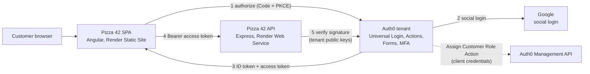

# Pizza 42

Angular 22 (zoneless) single-page app for a pizza-ordering site, built to demonstrate Auth0: sign-up and log-in
(passkeys, password, Google), a marketing opt-in collected during login, an email verification gate, and step-up MFA
for large orders. Orders go to a separate API that validates Auth0 access tokens.

| | |
|---|---|
| **Hosted app** | https://pizza-42.onrender.com |
| **Hosted API** | https://pizza-42-api.onrender.com |
| **This repo** | Angular app |
| **[pizza-42-api](https://github.com/MattM-1/pizza-42-api)** | Express orders API. Validates Auth0 access tokens and enforces scopes. |
| **[pizza-42-auth0](https://github.com/MattM-1/pizza-42-auth0)** | Exported Auth0 tenant configuration (Actions, Form, API, roles, MFA settings). |

## Architecture



### Step-up for orders over $100

```mermaid
sequenceDiagram
  participant B as SPA
  participant API as Pizza 42 API
  participant A as Auth0
  B->>API: POST /orders (Bearer token)
  API->>API: Verify token, scope, verified email; price the order
  alt total is $100 or less, or token has create:large-orders
    API-->>B: 201 order created
  else over $100 without the scope
    API-->>B: 403 step_up_required
    B->>A: /authorize with acr_values = multi-factor
    A->>A: MFA Action challenges or enrolls the user
    A->>A: Add High-Level Scopes adds create:large-orders
    A-->>B: New access token
    B->>API: Retry POST /orders
    API-->>B: 201 order created
  end
```

## What it shows

- **Sign up** and **Log in** through Auth0 Universal Login (Authorization Code + PKCE, via `@auth0/auth0-angular`). Passkeys, password and Google are available.
- Browsing the menu needs no login. Checkout requires login, and the cart survives the redirect (sessionStorage).
- Orders are placed through the orders API with an Auth0 access token. **The server prices the order**; the browser only sends pizza IDs, sizes and quantities.
- A **receipt** under the order button shows exactly what the API returned for the order.
- **My Orders** (`/orders`) lists the customer's orders from `GET /orders` and shows their **customer ID**.
- **My Account** (`/profile`, protected by `authGuardFn`) shows the profile, marketing preference and the raw ID token claims.

## Claims the app uses

| Claim | Token | Set by | Used for |
|---|---|---|---|
| `email_verified` | ID token (standard, from the `email` scope) | Auth0 | Enables "Place order" |
| `https://pizza42.example.com/marketing` | ID token | Marketing Action | Promo banner, Dough Club message, 15% discount shown in the cart |
| `https://pizza42.example.com/customer_id` | ID token | Add Customer ID Action | Customer ID shown on My Orders |

The API reads its own claims from the **access token** (see the API repo). The ID token is for the app only.

## Marketing opt-in via Auth0 Form + Action

A post-login Auth0 Action renders an Auth0 Form (one yes/no question: opt in to marketing emails for 15% off) on first
login and stores the answer in `app_metadata.marketing_opt_in`. On every login it adds the answer to the ID token, and
to the access token so the API can apply the same discount. Opted-in users see a promo banner and the 15% discount in
the cart (`marketing.service.ts`).

## Email verification gate

Users with an unverified email can log in and browse, but "Place order" is disabled until the ID token has
`email_verified: true` (see `menu.component.ts`). "I've verified my email" refreshes the tokens from Auth0. The API
enforces the same rule from the access token, so calling it directly does not bypass the gate.

## Step-up MFA for orders over $100

1. The app sends the order to the API. For an order over $100 without the `create:large-orders` scope, the API
   responds `403 { "error": "step_up_required" }`.
2. The app handles that response and starts a new authorize request with `acr_values` for multi-factor.
3. The Auth0 **MFA** Action challenges the user (TOTP or email), or enrolls them in TOTP if they have no second factor.
4. The **Add High-Level Scopes** Action adds `create:large-orders` to the access token, but only when MFA was
   triggered and completed in that same login. The user then places the order again.

The cart shows a notice whenever the total is over $100 so the extra check is expected.

## Auth0 setup

The tenant configuration lives in [pizza-42-auth0](https://github.com/MattM-1/pizza-42-auth0). To set it up by hand:

1. Create an application of type **Single Page Application**.
2. Set **Allowed Callback URLs**, **Allowed Logout URLs** and **Allowed Web Origins** to `http://localhost:4200`
   and your hosted URL (`https://pizza-42.onrender.com`).
3. Create an API with identifier `https://api.pizza42.example.com`. Enable **RBAC** and **Add Permissions in the Access Token**.
   Define the permissions `create:orders`, `read:orders` and `create:large-orders`.
4. Create a `customer` role with `create:orders` and `read:orders`. Do **not** add `create:large-orders` to the role:
   an Action grants it only after step-up MFA.
5. Deploy the post-login Actions from the Auth0 repo and add them to the Login flow in the order its README lists.
6. Put your Domain, Client ID, API audience and API URL in `src/auth0.config.ts`.

## Run locally

Requires Node `^22.22.3 || ^24.15.0 || ^26.0.0` (an `.nvmrc` for Node 26 is included). The orders API
(`pizza-42-api`) must be running at `http://localhost:3001`.

```bash
npm install
npm start     # http://localhost:4200
```

`npm start` (`ng serve`) uses the **development** environment and calls a local API at `http://localhost:3001`.
`ng build` uses the default environment and calls the hosted API. Both URLs live in `src/environments/`.

## Hosting (Render Static Site)

| Setting | Value |
|---|---|
| Build command | `npm install && npm run build` |
| Publish directory | `dist/pizza-42/browser` |
| Redirects/Rewrites | Rewrite `/*` to `/index.html`, so deep links such as `/menu` work in a single-page app |
| Auto-deploy | On every push to `main` |

Redirect, logout and API URLs are not hard-coded per host: the app uses `window.location.origin`, and the API URL comes from
the environment file chosen at build time. Add the hosted URL to the Auth0 application's callback, logout and web-origin lists.
